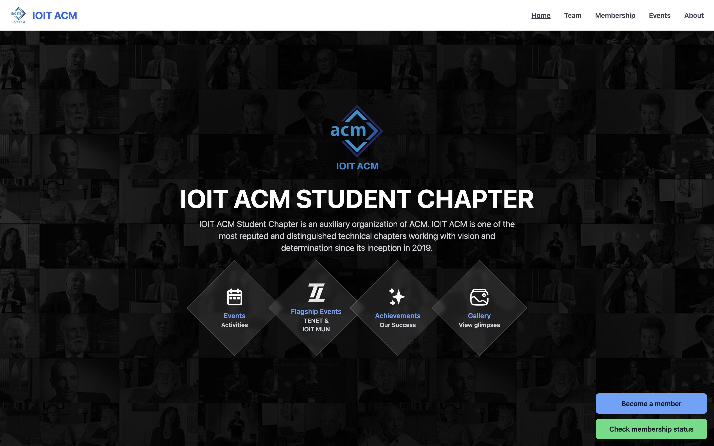
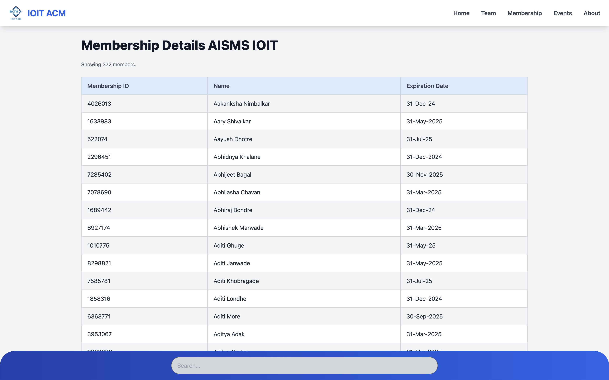

# AISSMS IOIT ACM Student Chapter Flask Project

This is a Flask project for the AISSMS IOIT ACM Student Chapter website.

[Production site](https://ioit.acm.org/)


_Home page_

_Membership Status_

_Footer_

## dependencies

1. Python (v3.12), managed with [uv](https://docs.astral.sh/uv/)

```
uv sync
```

2. Node.js (v26, see `.nvmrc`) for frontend libraries and TailwindCSS

```
npm ci
npm run vendor
```

Frontend libraries (Three.js, Font Awesome, Lucide, Chart.js, htmx, fabric.js, Remix Icon, Moment.js) are npm dependencies. `npm run vendor` copies the files the templates load into `app/static/vendor/`, which is gitignored, so rerun it after changing `package.json`. To use another Three.js addon, add it to `scripts/vendor.mjs`.

To rebuild `tailwind.css` while editing templates:

```
npm run watch:css
```

3. Local Email Testing (Mailpit)

For testing email notifications locally during development without sending real emails:
- Run Mailpit locally via Docker:
  ```bash
  docker run -d -p 1025:1025 -p 8025:8025 axllent/mailpit
  ```
- Configure `.env`:
  ```env
  MAIL_SERVER=localhost
  MAIL_PORT=1025
  MAIL_USE_TLS=False
  MAIL_USERNAME=
  MAIL_PASSWORD=
  ```
- All emails sent by Flask-Mail land in Mailpit's local web UI at `http://localhost:8025`.

## linting and formatting

Python is linted and formatted with [ruff](https://docs.astral.sh/ruff/), JavaScript with [biome](https://biomejs.dev/). Both run automatically on commit through [pre-commit](https://pre-commit.com/).

```
uv sync
npm install
uv run pre-commit install
```

To run them by hand:

```
make lint     # check only
make format   # apply fixes
```

## rate limiting

Rate limits are enforced with [Flask-Limiter](https://flask-limiter.readthedocs.io/). Where the counters live is set by `RATELIMIT_STORAGE_URI`:

| Environment | `RATELIMIT_STORAGE_URI` | Notes |
| --- | --- | --- |
| Local development | unset (defaults to `memory://`) | Counters live in the Python process. Fine for one dev server. |
| Production | `redis+unix:///home/<user>/redis/redis.sock` | Counters are shared by every worker process. |
| Any Redis over TCP | `redis://[:password@]host:6379/0` | Use `rediss://` for TLS. |

With `memory://`, every worker process (LiteSpeed `lswsgi` processes or Gunicorn workers) keeps its own counters, so a client gets the full limit once per process. Redis gives all processes one shared count.

If Redis is unreachable the app does not fail requests. It falls back to per-process in-memory limits and switches back once Redis responds again. Keys are prefixed with `ioit-acm` so the Redis instance can be shared with other apps.

### Running Redis on the cPanel host

The host has no system Redis service, but CloudLinux ships a Redis 6.2 binary at `/opt/alt/redis/bin/redis-server` that can run under the account user without root. It uses about 5 threads, which count towards the account's process limit.

`deploy/redis-keepalive.sh` starts it when it is not answering, on a private unix socket only (no TCP port), with nothing kept on disk and memory capped at 32MB. Every start is logged to `~/redis/keepalive.log`.

1. Run it once and check Redis responds:

   ```
   bash ~/ioit.acm/deploy/redis-keepalive.sh
   /opt/alt/redis/bin/redis-cli -s ~/redis/redis.sock ping   # PONG
   ```

2. Keep it running with cron (`crontab -e`). This starts Redis after a reboot and restarts it within 5 minutes if it stops:

   ```
   */5 * * * * bash $HOME/ioit.acm/deploy/redis-keepalive.sh
   ```

3. Add `RATELIMIT_STORAGE_URI=redis+unix:///home/<user>/redis/redis.sock` to the app's `.env` and restart the app.

### Tests

The Redis tests need a server and are skipped unless `TEST_REDIS_URL` is set. CI runs them against a Redis 6.2 service container.

```
TEST_REDIS_URL=redis://localhost:6379/15 uv run pytest
```

## deployment

Production runs on shared cPanel hosting (CloudLinux, LiteSpeed). The app is a Python 3.12 app from cPanel's **Setup Python App**, with its app root at `~/website-312`. The account has a 200 process limit that also counts threads, so lint and tests run in GitHub Actions and the server only installs and copies files.

### How a deploy works

Every push to `master` runs the `CI` workflow. Once `Lint` and `Test` pass, the `Deploy` job connects over SSH, checks out that exact commit in `~/ioit.acm` and runs [`deploy/deploy.sh`](deploy/deploy.sh), which:

1. Installs Python dependencies from `uv.lock` into `~/virtualenv/website-312/3.12` with uv, only when `uv.lock` changed. uv runs with capped concurrency.
2. Runs `npm ci --omit=dev` when `package-lock.json` changed, then `npm run vendor`.
3. Saves the live `app/`, `wsgi.py` and `passenger_wsgi.py` to `~/releases/website/previous`.
4. Copies `app/`, `wsgi.py` and `passenger_wsgi.py` into `~/website-312` and restarts the app (`tmp/restart.txt`). `app/static/uploads/` is never overwritten or deleted, since it holds files uploaded through the admin pages.
5. Requests `https://ioit.acm.org/`. If it does not return 200 within about 30 seconds, it restores the saved release, restarts again and fails the job.

Only one deploy runs at a time. To deploy by hand, run the same commands as the workflow:

```
git -C ~/ioit.acm fetch origin
git -C ~/ioit.acm reset --hard origin/master
bash ~/ioit.acm/deploy/deploy.sh
```

### One-time server setup

- **Python app**: in cPanel **Setup Python App**, the app on `ioit.hosting2.acm.org` (the account's main domain, which serves `ioit.acm.org`) uses Python 3.12 with app root `website-312` at URL `/`, startup file `wsgi.py` and entry point `app`. LiteSpeed loads `passenger_wsgi.py` from the app root, which the deploy copies from the repo.
- **uv**: a pinned uv binary in `~/.local/bin/uv`.
- **Node**: the version in `.nvmrc`, installed with `nvm install`.
- **Redis**: see [rate limiting](#running-redis-on-the-cpanel-host).
- **Environment**: `~/website-312/.env` holds the production values for every key in `.env.example`.

### Upgrading Python

Do not change the Python version of the existing app in **Setup Python App**. LiteSpeed caches each app's Python home by its app folder, so after an in-place switch the new interpreter starts with the old version's home and the site returns 503. Restarting the app does not clear it. Instead, create a new app next to the old one and swap their URLs:

1. Create the new app on the new version in its own folder at a temporary URL, for example `website-313` at `/py313-staging`:

   ```
   cloudlinux-selector create --json --interpreter python --domain ioit.hosting2.acm.org --app-root website-313 \
     --app-uri py313-staging --version 3.13 --startup-file wsgi.py --entry-point app
   ```

2. Copy `.env` from the current app folder into the new one, update `APP_ROOT` and `VENV` in `deploy/deploy.sh`, and deploy to the new folder with `HEALTH_URL=https://ioit.acm.org/py313-staging/`. The selector writes its own `passenger_wsgi.py` when it creates an app, and the deploy replaces it with the repo's.
3. Check the site at the staging URL, then swap the URLs. This takes effect within a few seconds:

   ```
   cloudlinux-selector set --json --interpreter python --app-root website-312 --new-app-uri legacy --skip-web-check
   cloudlinux-selector set --json --interpreter python --app-root website-313 --new-app-uri / --skip-web-check
   ```

4. To roll back, move the new app off `/` first (`--app-root website-313 --new-app-uri py313-staging`), then the old app back (`--app-root website-312 --new-app-uri /`). Once the new app has been stable for a while, remove the old one with `cloudlinux-selector destroy --json --interpreter python --app-root website-312`.

## data

1. Teams
   The `app/data/teams.py` file contains information about the members of the AISSMS IOIT ACM committee, organized by year.

2. Events
   The `app/data/events.py` file contains a list of events organized by name, description, and date. Here's the structure:

## build.sh

Currently, there is no Git integration in this project. However, the `build.sh` file located in the root directory serves as a utility to copy the necessary project files to a specified destination directory (`$DEST_DIR`). These files can then be zipped and uploaded to cPanel for hosting.

### Instructions:

1. **Set the Destination Directory**
   Modify the `$DEST_DIR` variable in the script to specify the desired location where the project files will be copied.

2. **Make the Script Executable** (Optional)
   To ensure that the script is executable, you can run the following command:

   ```bash
   chmod +x build.sh
   ```

3. **Run the Script**
   After making the script executable, run it with:
   ```bash
   ./build.sh
   ```

## Available Routes

The following routes are available in the project:

- [x] **`/`**: The home page of the site.
- [x] **`/about`**: The about page.
- [x] **`/membership`**: The membership page.
- [x] **`/membership/status`**: A page showing membership status.
- [x] **`/gallery`**: A page (currently under development) displaying images or events.
- [x] **`/team`**: A page with details of the AISSMS IOIT ACM committee members.
- [x] **`/events`**: A page displaying upcoming events.
- [x] **`/events/{event.name}`**: Event details page.

## ACM Membership Data Management

This project manages ACM membership data by integrating with the SheetsDB API and providing a fallback mechanism using a `snapshot.json` file. When the monthly API quota is exceeded, the data is retrieved from the snapshot file.

---

## Overview

### API Integration

The membership data is fetched from SheetsDB using the provided API endpoint and Bearer token. The data is cached for performance, and a fallback JSON file (`snapshot.json`) is used when:

- The API quota is exceeded.
- The API is unavailable due to network or other issues.

### Snapshot File

The `snapshot.json` file is a local backup of the membership data. It should be updated regularly to ensure it reflects the latest data.

To update the snapshot file:

```shell
curl -X GET https://sheetdb.io/api/v1/vn9yo1yzudzoh \
-H "Authorization: Bearer BEARER_TOKEN" > snapshot.json
```

> NOTE: Get the bearer token from the sheetdb console.

## Update data

Python files for data are located in `app/static/data`.

---

### 1. Events (`events.py`)

#### Structure:

- The `events.py` file contains a list of events in the form of dictionaries.
- Each event has the following fields:
  - **`name`**: The title of the event (e.g., "National Level FDP on Cyber Security").
  - **`description`**: A brief overview of the event.
  - **`date`**: The date(s) of the event (e.g., "October 21, 2024 - October 25, 2024").
  - **`image_url`**: A URL to an image representing the event, which can be used for display purposes.
  - **`instagram_link`**: The Instagram link for the event, if available.
  - **`facebook_link`**: The Facebook link for the event, if available.
  - **`topics`**: A list of topics covered during the event.

Example:

```python
events = [
    {
        "name": "National Level FDP on Cyber Security",
        "description": "A faculty development program focused on cyber security topics.",
        "date": "October 21, 2024 - October 25, 2024",
        "image_url": "",
        "instagram_link": "",
        "facebook_link": "",
        "topics": [
            "We discussed the fundamentals of cyber security, including key concepts such as firewalls, encryption, and authentication.",
            "We explored network security techniques to prevent unauthorized access and attacks on computer networks.",
            "We learned about cryptographic methods used to secure communications and protect sensitive information.",
            "We talked about emerging cyber threats like ransomware and phishing, and how to mitigate them using various defense strategies.",
            "We covered risk management approaches to identify vulnerabilities and create robust protection strategies.",
        ],
    },
]
```

#### Usage in the Codebase:

- Events are dynamically rendered in Jinja2 templates via a `for` loop, typically used on event listing or event detail pages.
- The route for each individual event details page is dynamically created using the event’s name as a slug: `/events/{event.name}`. For example, a URL for "National Level FDP on Cyber Security" would be `/events/National%20Level%20FDP%20on Cyber Security`.

#### Precautions:

- **Event name formatting**:

  - Do not use special characters in event names (e.g., `@`, `#`, `&`).
  - Avoid using hyphens (`-`) and slashes (`/`) in event names, as they may conflict with route generation and URL structure.
  - If an event name contains spaces, consider replacing them with underscores (`_`) for compatibility with the URL structure.

- **Image URLs**:
  - Only use appropriate image paths from the `static` folder.
  - If no image is available for an event, leave the `image_url` field empty.

---

### 2. Teams (`teams.py`)

#### Structure:

- The `team_data` variable contains a dictionary with team members categorized by year (e.g., "2024", "2023", "2022").
- Each team entry includes the following fields:
  - **`name`**: The name of the team member.
  - **`title`**: The role or title of the team member (e.g., "Chair", "Vice Chair").
  - **`image`**: The file path to an image of the team member, typically located under `static/img/team/{year}/`.
  - **`linktree`**: A link to the team member's Linktree, if available.
  - **`github`**: The team member's GitHub profile link, if available.
  - **`linkedin`**: The team member's LinkedIn profile link, if available.
  - **`instagram`**: The team member's Instagram profile link, if available.
  - **`domain`**: The domain of work the team member belongs to (e.g., "core", "events", "web", "documentation").

#### Usage in the Codebase:

- This file is used to render team members' information on team-related pages or sections of the website, with each member's details linked to their social media profiles (LinkedIn, GitHub, etc.).
